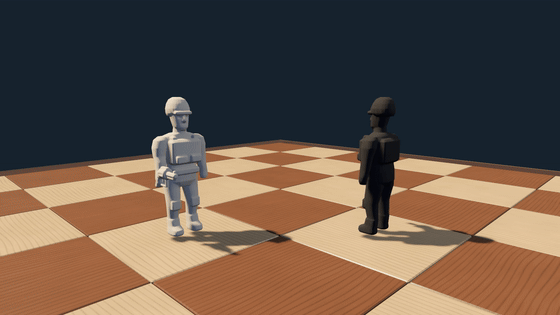
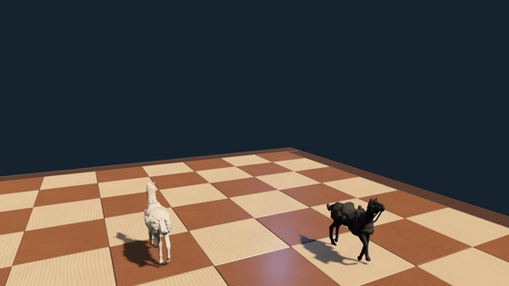
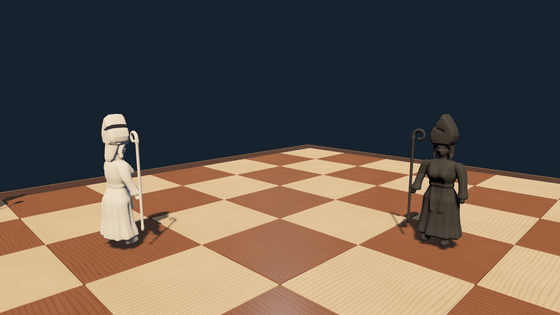
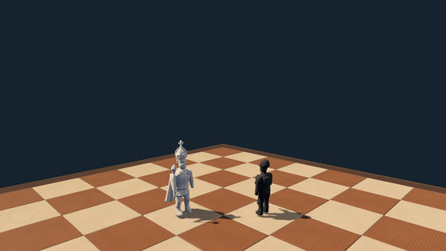

# Battle Chess 3D


This is Chess, with a twist. Inspired by *Battle Chess*, released for MS-DOS in
[January 1989]([https://classicreload.com/battle-chess.html]),
BattleChess 3D
takes that idea in a modern direction with animated 3D characters and explosive projectile captures. Every piece has a different capture animation. 

3d Chess game, written in the Rust programming language.

The game follows standard chess rules and lets you play locally against another
person or the built-in CPU.

- **Pawn:** Fires holographic bullets.
- **Knight:** Launches a cannonball that splits into smaller cannonballs in
  mid-flight.
- **Bishop:** Fires three glowing ball-lightning orbs with branching violet
  lightning.
- **Rook:** Opens its parapet to launch a drone, which drops a grenade and returns.
  The rook then unfolds brick arms and legs to move into the captured square.
- **Queen:** Fires a staggered barrage of eight artillery shells, with smoke at
  each impact.
- **King:** Drops an atomic bomb over the target, followed by an explosion and a
  mushroom cloud.


## The game

- **Standard chess rules:** legal moves, check, checkmate, castling, en passant,
  promotion, stalemate, repetition, insufficient material, and the fifty-move rule.
- **Animated battles:** the attacker fires, the captured piece reacts, and the
  attacker takes its square after the projectile effects finish.
- **Character movement:** the horse-shaped knight leaps along an L-shaped route,
  lands and pivots at the corner, then leaps again. Pieces in its path step aside.
  The rook unfolds brick arms and legs to move, then returns to a castle parapet.
- **Local play or CPU:** play both sides locally or let the CPU control either color.
  Optional chess clocks pause during capture effects.
- **Customizable:** choose walnut, marble, tournament, slate, obsidian, or
  neon finishes for the board; adjust piece colors and materials; orbit, pan, tilt, and zoom in to inspect the figures.
- **A checkmate celebration:** the losing side kneels together, fireworks spray
  from all four corners, and a gold-trimmed plaque announces the winner with a
  New game button. The board stays visible.

## Capture animations

Each GIF shows the named piece making a capture, including its projectile,
the target's defeat reaction, and the attacker's arrival. These are recordings
of the game's actual animation systems.

### Pawn — holographic bullets

A modern soldier fires a short burst of small cyan holographic bullets from a revolver.



### Knight — splitting cannonball

The warhorse launches a cannonball that breaks into smaller rounds in flight,
then follows its two-stage L-shaped leap to the captured piece's square.



### Bishop — ball lightning

A robed bishop sends glowing orbs with branching violet lightning toward the target.



### Rook — drone and grenade

The parapet opens, a drone flies out and drops a grenade, then returns to the tower.


### Queen — artillery barrage

The queen sends a staggered barrage of artillery shells with impact smoke.


### King — atomic bomb

The king drops an atomic bomb over the target, followed by a mushroom cloud.
In this example, the king captures a pawn.



The GIFs are stored in [`docs/animations`](docs/animations).

## Build and run

With Rust 1.95 or newer, Cargo, and a compatible Windows linker installed, run
these commands from the project directory containing `Cargo.toml`.

Build the executable:

```powershell
cargo build --release --locked --bin battle-chess-3d
```

Build and run with Cargo:

```powershell
cargo run --release --locked --bin battle-chess-3d
```

Run the compiled executable:

```powershell
.\target\release\battle-chess-3d.exe
```

If `CARGO_TARGET_DIR` is set, the executable is in that directory's `release` folder.

## Controls

| Input | Action |
| --- | --- |
| Left click | Select a piece, then its destination |
| Left mouse drag in the board area | Orbit and tilt the camera |
| **Hold Ctrl + left mouse drag** | **Pan the camera** |
| Mouse wheel | Zoom in or out over the board |
| Q / E | Orbit the camera |
| Z / X | Zoom in / out |
| F | Flip the board |
| Arrow keys | Move the board cursor |
| Enter / Space | Select the cursor square |
| Escape | Cancel selection |

The sidebar includes New game, Undo, Flip, CPU settings, camera controls, clocks,
appearance settings, and move history. **Reset view** restores the camera's
position and clears panning. The **Battle animations** toggle controls animated
movement and capture effects.

## Project layout

| Path | Contents |
| --- | --- |
| `src/main.rs` | Application setup, sidebar, input, camera, and capture lifecycle |
| `src/game.rs` | Chess rules, history, captured material, and undo |
| `src/cpu.rs` | Built-in CPU search and evaluation |
| `src/characters/` | Character rigs, skinned meshes, movement, and poses |
| `src/projectiles/` | Piece-specific projectile and impact effects |
| `src/board.rs` | Board geometry and materials |
| `src/checkmate.rs`, `src/endgame.rs` | Fireworks and the victory plaque |
| `art/` | Required embedded character meshes and asset credits |
| `docs/blender/` | Blender source scripts and their shared mesh helper |
| `docs/stl/` | Exported STL models of the six game pieces |
| `docs/animations/` | Capture GIFs and the board overview image |

## License and asset credits

The game code is licensed under [MIT](LICENSE).

The knight adapts MZ4250's
[Warhorse Mount w and w/o Mini Slot](https://www.printables.com/model/772400-warhorse-mount-w-and-wo-mini-slot/files),
licensed under [CC BY 4.0](https://creativecommons.org/licenses/by/4.0/).
The adaptation levels the stride, raises the head, shortens the tail, reduces the
mesh, and adds an animation rig. See the [asset credits](art/README.md#knight-attribution).

The other in-game characters are original BattleChess sculpts. See the
[asset inventory and credits](art/README.md).
