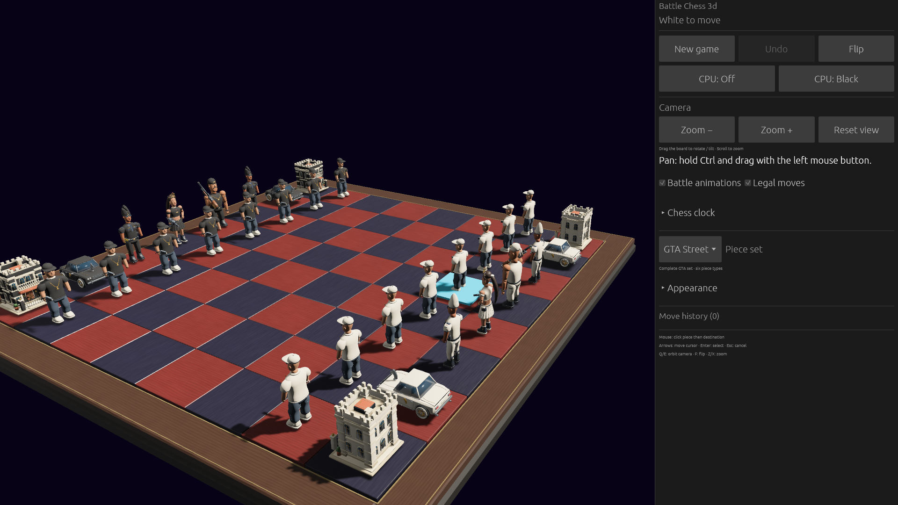
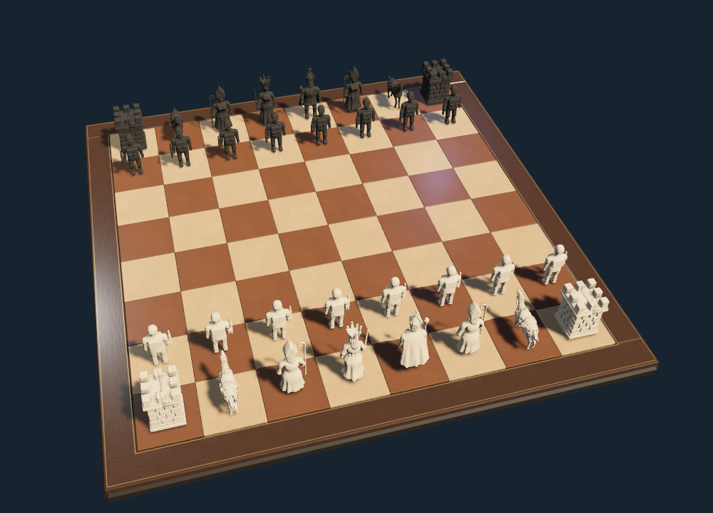
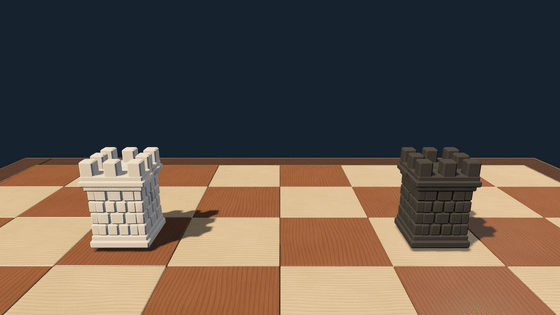
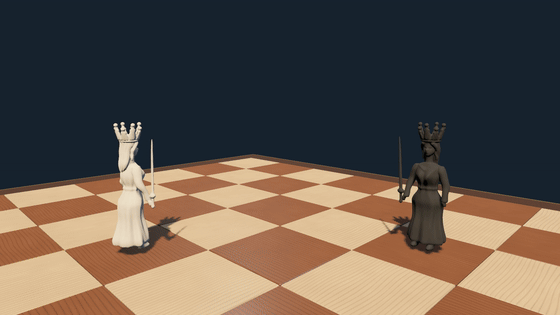

# Battle Chess 3D

Choose **Piece set → GTA Street** in the in-game menu for the streetwear pawn,
lowrider knight, mansion rook, police bishop, shotgun king, and mini-Uzi queen.
All six piece types are now available in the GTA Street set. The pawn fires three
small brass rounds. The lowrider launches a drone from its trunk. The mansion
opens a rooftop hatch and
lobs a rotating Molotov, followed by a brief fire effect at the captured square.
Its stone-and-metal legs extend for movement and castling, then retract into
the foundation when it stops.
The police bishop raises a yellow taser, fires two tethered darts, and delivers
two electrical pulses before the defender falls. It then patrols diagonally
into the captured square.
The bishop's shirt, pants, and helmet follow the team piece colors under Appearance.
The barrel-chested king has a mustache and tied bandanna. His shotgun rests
diagonally against his shoulder while idle and walking. For a capture he lowers
it into a firing stance, blasts a spread of small pellets, recoils, and returns
it to his shoulder. A brief muzzle flash, smoke, and one ejected shell accompany
the shot. His tank top, trousers, and bandanna follow the selected team color.
The queen wears a crop top, pleated skirt, tiara, and long ponytail. She raises
a compact mini Uzi and fires a sweeping ten-round burst. Early hits cause brief
flinches; the last round triggers the defender's fall. Each shot has recoil,
a muzzle flash, and an ejected casing. Her outfit follows the team piece color.
Casings fall beside her and settle on the board. Every defender receives the
same brief red-fluid spray and gray smoke during her burst.
**Original** remains available with its original attacks.
See [`art/street_pawn`](art/street_pawn), [`art/lowrider`](art/lowrider),
[`art/mansion`](art/mansion), [`art/police_bishop`](art/police_bishop),
[`art/street_king`](art/street_king), and [`art/street_queen`](art/street_queen)
for STLs, editable models and asset sources.
Each GTA piece includes original geometry and its own capture animation.



This is Chess, with a twist. Inspired by *Battle Chess*, released for MS-DOS in
[January 1989](https://www.mobygames.com/game/1950/battle-chess/releases/dos/),
BattleChess 3D
takes that idea in a modern direction with animated 3D characters and explosive projectile captures. Every piece has a different capture animation.

3d Chess game, written in the Rust programming language.

The game follows standard chess rules and lets you play locally against another
person or the built-in CPU.

The Original set uses these capture animations:

- **Pawn:** Fires holographic bullets.
- **Knight:** Launches a cannonball that splits into smaller cannonballs in
  mid-flight.
- **Bishop:** Fires three glowing ball-lightning orbs with branching violet
  lightning.
- **Rook:** Opens its parapet to launch a drone, which drops a grenade and returns.
  The rook then unfolds brick arms and legs to move into the captured square.
- **Queen:** Fires a staggered barrage of eight artillery shells, with smoke at
  each impact.
- **King:** Drops an atomic bomb over the target, followed by an explosion and a
  mushroom cloud.



## The game

- **Standard chess rules:** legal moves, check, checkmate, castling, en passant,
  promotion, stalemate, repetition, insufficient material, and the fifty-move rule.
- **Animated battles:** the attacker fires, the captured piece reacts, and the
  attacker takes its square after the projectile effects finish.
- **Character movement:** the horse-shaped knight leaps along an L-shaped route,
  lands and pivots at the corner, then leaps again. Pieces in its path step aside.
  The rook unfolds brick arms and legs to move, then returns to a castle parapet.
- **Local play or CPU:** play both sides locally or let the CPU control either color.
  Optional chess clocks pause during capture effects.
- **Customizable:** choose walnut, marble, tournament, slate, obsidian, or
  neon finishes for the board; adjust piece colors and materials; orbit, pan, tilt, and zoom in to inspect the figures.
- **A checkmate celebration:** the losing side kneels together, fireworks spray
  from all four corners, and a gold-trimmed plaque announces the winner with a
  New game button. The board stays visible.

## How the 3D models and Rust animations work

Battle Chess 3D uses **Blender and Python to build its character geometry**, then
**Rust and Bevy to display, pose, move, and animate that geometry**. The exported
STLs are useful for inspecting or printing the models, but the game **does not
load or animate STL files at runtime**. It uses a separate, joint-aware binary
mesh format.

### 1. Generate the models and STLs in Blender with Python

The six piece-generation scripts live in [`docs/blender/`](docs/blender/README.md):
[`build_pawn.py`](docs/blender/build_pawn.py),
[`build_knight.py`](docs/blender/build_knight.py),
[`build_bishop.py`](docs/blender/build_bishop.py),
[`build_rook.py`](docs/blender/build_rook.py),
[`build_queen.py`](docs/blender/build_queen.py), and
[`build_king.py`](docs/blender/build_king.py).

They use Blender's Python API (`bpy`) to construct or adapt the piece geometry.
For example, the bishop, queen, and king scripts define profiles and sculpted
details in Python. Their shared helper,
[`docs/blender/figure_mesh.py`](docs/blender/figure_mesh.py), builds lofted
surfaces, smooths and voxel-remeshes the geometry, reduces polygon counts,
triangulates faces, and exports the finished model. **This is the repository's
shared final-mesh export helper; there is no script named `finalmesh.py`.**
The pawn and knight have their own export implementations, while the rook
exports multiple rigid parts for its animated hatches and walking limbs.

To regenerate a piece from the repository root, run its script inside Blender:

```sh
blender --background --factory-startup --python docs/blender/build_bishop.py
```

Each build produces **two different outputs from the model**:

- **`docs/stl/<piece>.stl`** — a neutral/resting-pose STL exported by
  Blender with `bpy.ops.wm.stl_export`. These are reference/3D-printable
  geometry exports, **not** the runtime animation assets.
- **`art/<piece>/*.mesh`** — the game's custom binary meshes, containing
  vertex positions and normals, triangle indices, and, for skinned characters,
  rest-joint positions plus up to four joint indices and weights per vertex.
  The exporter writes the `BCM1` or `BCM2` binary format consumed by Rust.

The knight is a special case: its build script adapts an attributed third-party
warhorse STL as **input**, then writes the game's adapted
`art/knight/warhorse.mesh` and `docs/stl/warhorse.stl`. See the
[Blender instructions](docs/blender/README.md#knight-source) for the original
model and the required `--source` argument.

### 2. Load and animate the meshes in Rust

In [`src/characters/model.rs`](src/characters/model.rs), Rust embeds the
`art/` meshes directly into the executable with `include_bytes!`.
[`src/characters/model/skin.rs`](src/characters/model/skin.rs) then decodes
the binary vertices, normals, indices, joint IDs, and skin weights into a
Bevy `Mesh`. It constructs the inverse bind poses and spawns a `Mesh3d`
with a `SkinnedMesh` component and a hierarchy of joint entities.

A skinned vertex can be influenced by up to four joints. Moving an arm or leg
joint changes how Bevy deforms the attached vertices, rather than rebuilding
the whole mesh for each animation frame. The rook is different: its tower,
hatches, and limb bricks are **separate rigid meshes**, and Rust animates
those parts with transforms.

The motion itself is also **written in Rust**, not baked into the STLs.
[`src/characters/animation.rs`](src/characters/animation.rs) defines
`Pose` values for the body, head, arms, legs, weapons, cloth, and hatches;
keyframe interpolation and easing blend poses smoothly. The character systems
in [`src/characters.rs`](src/characters.rs) update these poses as pieces
walk, attack, react to hits, and travel to their destination squares. Even the
knight's two-stage L-shaped leap and the rook's unfold/walk/fold sequence are
controlled by code.

### 3. Build every projectile animation in Rust

**The projectile flights and effects are procedural Rust code**, not Blender
animations. [`src/projectiles.rs`](src/projectiles.rs) creates Bevy meshes
and materials for the shots, assigns each chess role an attack `profile()`
(projectile count, launch delay, flight time, stagger, and arc), and spawns
projectile entities. Every update, `Projectile::position(t)` and
`Projectile::rotation(t)` calculate where the projectile belongs and which
way it faces.

For ordinary arcing shots, the position starts with a straight interpolation
from attacker to target, then adds a parabolic lift using
`4.0 * t * (1.0 - t)` (where `t` runs from 0 to 1). Piece-specific logic
adds spread, height, spirals, or different flight paths:

- **Pawn:** three staggered holographic bullets.
- **Knight:** a cannonball splits into four smaller rounds in
  [`cannon.rs`](src/projectiles/cannon.rs).
- **Bishop:** branching lightning meshes and flickering patterns in
  [`lightning.rs`](src/projectiles/lightning.rs).
- **Rook:** a timed drone flight, grenade drop, and return trip in
  [`drone.rs`](src/projectiles/drone.rs).
- **Queen:** staggered artillery shells with smoke and impact effects in
  [`artillery.rs`](src/projectiles/artillery.rs).
- **King:** a falling bomb followed by an animated flash, shockwave, dust,
  and mushroom cloud in [`bomb.rs`](src/projectiles/bomb.rs).

Finally, [`src/main.rs`](src/main.rs) keeps captures synchronized with
these effects: it stores a legal capture as a **pending move**, leaves the
defender visible while the attack plays, and only commits the chess move after
the relevant projectiles and explosion effects finish.

## Capture animations

Each GIF shows the named piece making a capture, including its projectile,
the target's defeat reaction, and the attacker's arrival. These are recordings
of the game's actual animation systems.

### Pawn — holographic bullets

A modern soldier fires a short burst of small cyan holographic bullets from a revolver.


### Knight — splitting cannonball

The warhorse launches a cannonball that breaks into smaller rounds in flight,
then follows its two-stage L-shaped leap to the captured piece's square.


### Bishop — ball lightning

A robed bishop sends glowing orbs with branching violet lightning toward the target.


### Rook — drone and grenade

The parapet opens, a drone flies out and drops a grenade, then returns to the tower.



### Queen — artillery barrage

The queen sends a staggered barrage of artillery shells with impact smoke.



### King — atomic bomb

The king drops an atomic bomb over the target, followed by a mushroom cloud.
In this example, the king captures a pawn.


The GIFs are stored in [`docs/animations`](docs/animations).

## Build and run

With Rust 1.95 or newer, Cargo, and a compatible Windows linker installed, run
these commands from the project directory containing `Cargo.toml`.

Build the executable:

```powershell
cargo build --release --locked --bin battle-chess-3d
```

Build and run with Cargo:

```powershell
cargo run --release --locked --bin battle-chess-3d
```

Run the compiled executable:

```powershell
.\target\release\battle-chess-3d.exe
```

If `CARGO_TARGET_DIR` is set, the executable is in that directory's `release` folder.

To render the GTA showcase images from the game:

```powershell
cargo run --features asset-preview -- --readme-screenshots target/readme-previews
```

## Controls

| Input | Action |
| --- | --- |
| Left click | Select a piece, then its destination |
| Left mouse drag in the board area | Orbit and tilt the camera |
| **Hold Ctrl + left mouse drag** | **Pan the camera** |
| Mouse wheel | Zoom in or out over the board |
| Q / E | Orbit the camera |
| Z / X | Zoom in / out |
| F | Flip the board |
| Arrow keys | Move the board cursor |
| Enter / Space | Select the cursor square |
| Escape | Cancel selection |

The sidebar includes New game, Undo, Flip, CPU settings, camera controls, clocks,
appearance settings, and move history. **Reset view** restores the camera's
position and clears panning. The **Battle animations** toggle controls animated
movement and capture effects.

Under **Appearance**, click a color square to open its menu with a visual picker
and large **Hex** and **RGB** text fields. Enter `#FF8040`, `FF8040`, or shorthand
`#F84` for hex; enter
`255, 128, 64` or `rgb(255, 128, 64)` for RGB. Valid values apply immediately
and keep the other field and picker in sync. Invalid entries show a hint and
retain the last valid color. Press Escape in a field to restore its current value.
The picker and text fields sit side by side so the entire menu is visible without scrolling.

## Project layout

| Path | Contents |
| --- | --- |
| `src/main.rs` | Application setup, sidebar, input, camera, and capture lifecycle |
| `src/game.rs` | Chess rules, history, captured material, and undo |
| `src/cpu.rs` | Built-in CPU search and evaluation |
| `src/characters/` | Character rigs, skinned meshes, movement, and poses |
| `src/projectiles/` | Piece-specific projectile and impact effects |
| `src/board.rs` | Board geometry and materials |
| `src/checkmate.rs`, `src/endgame.rs` | Fireworks and the victory plaque |
| `art/` | Required embedded character meshes and asset credits |
| `docs/blender/` | Blender source scripts and their shared mesh helper |
| `docs/stl/` | Exported STL models of the six game pieces |
| `docs/animations/` | Capture GIFs and the board overview image |

## License and asset credits

The game code is licensed under [MIT](LICENSE).

The knight adapts MZ4250's
[Warhorse Mount w and w/o Mini Slot](https://www.printables.com/model/772400-warhorse-mount-w-and-wo-mini-slot/files),
licensed under [CC BY 4.0](https://creativecommons.org/licenses/by/4.0/).
The adaptation levels the stride, raises the head, shortens the tail, reduces the
mesh, and adds an animation rig. See the [asset credits](art/README.md#knight-attribution).

The other in-game characters are original BattleChess sculpts. See the
[asset inventory and credits](art/README.md).
